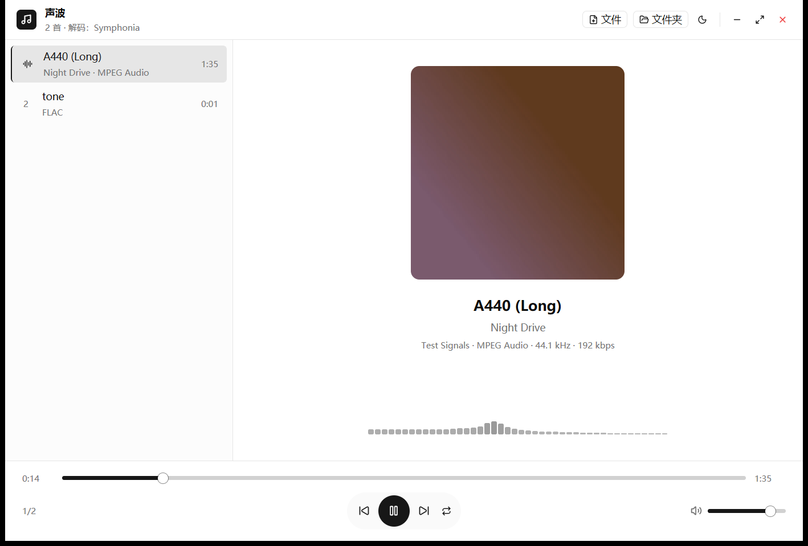

# 声波 · ngy-audio-player

跨平台桌面音频播放器。Windows / macOS / Linux 同一套代码，界面用
[GPUI Kit](https://gpui-kit.com)（Zed 的 GPUI + gpui-component），音频走
Symphonia + 系统 ffmpeg 双层解码。



## 能播什么

「所有已知音频格式」这句话在工程上需要拆成两层看：

| 层 | 实现 | 覆盖 |
| --- | --- | --- |
| 内置 | Symphonia（纯 Rust，无 C 依赖） | MP3 / MP2 / MP1、AAC（ADTS / M4A / MP4）、ALAC、FLAC、WAV、AIFF、CAF、Vorbis（OGG）、Matroska / WebM 里的音轨 |
| 兜底 | 系统 `ffmpeg` 子进程 | Opus、Speex、WMA、APE、WavPack、TTA、TAK、Musepack、DSD（DSF / DFF）、AMR、AC-3 / E-AC-3、DTS、RealAudio、AU、VOC、Wave64、tracker 模块，以及视频容器里的音轨 |

选择策略**不看扩展名**：先试内置解码器，它解不出来才落到 ffmpeg。原因是 `.ogg`
里既可能是 Vorbis 也可能是 Opus，按扩展名判会判错。

两条路径都会在打开时**试解第一块**才算成功 —— 只探测到容器头不代表能出声，
否则错误会被推迟到播放到一半才冒出来。

实测记录（`cargo test -p ngy-audio-engine --test formats -- --nocapture`）：

```
tone.aac        Symphonia   44100 Hz  1.231s      tone.opus       FFmpeg  48000 Hz  1.200s
tone.m4a        Symphonia   44100 Hz  1.231s      tone.spx        FFmpeg  48000 Hz  1.200s
tone_alac.m4a   Symphonia   44100 Hz  1.200s      tone.wma        FFmpeg  48000 Hz  1.161s
tone.flac       Symphonia   44100 Hz  1.200s      tone.wv         FFmpeg  48000 Hz  1.200s
tone.mp3        Symphonia   44100 Hz  1.200s      tone.ape*       需要样本，未入测试
tone.ogg        Symphonia   44100 Hz  1.200s      tone.ac3        FFmpeg  48000 Hz  1.219s
tone.wav        Symphonia   44100 Hz  1.200s      tone.tta        FFmpeg  48000 Hz  1.200s
tone.aiff       Symphonia   44100 Hz  1.200s      tone.amr        FFmpeg  48000 Hz  1.220s
tone.caf        Symphonia   44100 Hz  1.200s      tone.au         FFmpeg  48000 Hz  1.200s
tone.mka        Symphonia   44100 Hz  1.220s      tone.w64        FFmpeg  48000 Hz  1.200s
tone.3gp        Symphonia   44100 Hz  1.231s
```

（`*` APE 只有解码器没有编码器，ffmpeg 生成不出样本，所以没进自动化测试。）

## ffmpeg 是可选的

没装 ffmpeg 时，内置那批格式照常播，界面顶部会明说「未装 ffmpeg，部分格式不可用」。
装法：

- Windows：`winget install Gyan.FFmpeg`，或把 ffmpeg 解压到 `C:\ffmpeg\bin`
- macOS：`brew install ffmpeg`
- Ubuntu/Debian：`sudo apt install ffmpeg`

程序按这个顺序找：环境变量 `NGY_AUDIO_FFMPEG` → `PATH` → 各平台常见安装目录。
找到之后会真跑一次 `ffmpeg -version` 验证，同名但不可执行的文件不算。

## 构建与运行

```bash
cargo run --release                 # 空界面，拖文件进去
cargo run --release -- a.mp3 b.flac # 直接播
```

三平台都能 `cargo build --release`；Windows 需要 MSVC 工具链，Linux 需要
`libasound2-dev`（cpal 的 ALSA 后端）。

## 设为默认播放器（仅 Windows）

顶栏的「设为默认」按钮会把本程序登记到当前用户（`HKCU`，不需要管理员权限）：
65 种音频格式进入「打开方式」，同时也出现在系统默认应用页里。登记完会自动打开
声波那一页 —— 还要在那里把这些格式设成用声波打开，才真正生效。Windows 8 之后不允许
程序代写 `UserChoice`，代写属于劫持，系统升级后还会失效，所以这里只登记、不硬设
（见 [ADR 0007](docs/adr/0007-register-but-never-force-default.md)）。

视频容器（`mp4`、`mkv`、`avi` 等 18 个）不在登记范围：它们能放出声音，但不该把
默认程序抢走。菜单项会显示「已登记 / 已默认 n/65 / 已是默认」，再点一次可以「取消登记」。

不想逐项点系统设置的话，确认层里还有一个 **「直接设为默认」**：程序自己算 `UserChoice`
的哈希直接写注册表，一次覆盖全部 65 种。它绕过了 Windows 的默认程序保护，系统大版本
更新后可能失效（表现是双击又弹选择框，届时回到系统设置点一次即可），详见
[ADR 0008](docs/adr/0008-force-default-is-an-explicit-opt-in.md)。

## 快捷键

| 键 | 作用 |
| --- | --- |
| `空格` | 播放 / 暂停 |
| `←` / `→` | 后退 / 前进 5 秒 |
| `↑` / `↓` | 音量 ±5% |
| `n` / `p` | 下一首 / 上一首 |
| `Delete` | 从列表移除当前曲目 |

## 结构

```
crates/audio/            音频内核（不依赖 GPUI，可单独测试）
  src/decode/            两条解码路径，统一成 2 声道交错 f32
  src/resample.rs        设备采样率不一致时做 FFT 重采样
  src/output.rs          cpal 输出 + 无锁环形缓冲
  src/state.rs           音频线程与 UI 之间唯一的共享面（原子量）
  src/engine.rs          线程模型与状态机
src/                     界面层
  src/ui/player_view.rs  列表 / 封面 / 进度 / 传输控制
  src/ui/spectrum.rs     频谱柱
```

线程模型一句话：**解码线程写、音频回调读，中间只有一个环形缓冲**。回调里不加锁、
不分配、不做 IO；位置时钟由回调按「实际写出的帧数」推进，所以暂停时进度条不会自己走。

## 已知边界

- `cargo test` 里的格式测试依赖 `testdata/` 样本；没有样本时测试会打印一句跳过。
- 每个文件算一条曲目：CUE 整轨还不能分轨，整轨就是一条很长的曲目。
- 5.1 / 7.1 素材只播前两声道，中置、环绕、低频不出声。
- 每次切歌都会清空缓冲，跨文件做不到无缝（gapless）。
- 设备热插拔（拔耳机）只在控制台打日志，不会自动重建音频流。
- 只播本地文件：不接网络流，运行时也不联网（不检查更新）。
- 不做位精确输出（独占模式、DSD 原生），始终走系统默认设备与系统混音。
- 没有曲库视图：不扫描文件夹建索引。
- 没有歌词、ReplayGain、EQ、变速变调，也不能写回标签。
- MIDI 需要音源合成，ffmpeg 也放不出来，不在支持范围。
- 以上哪些会在 v1 内修掉、哪些明确不做，见 [docs/v1-scope.md](docs/v1-scope.md)。
